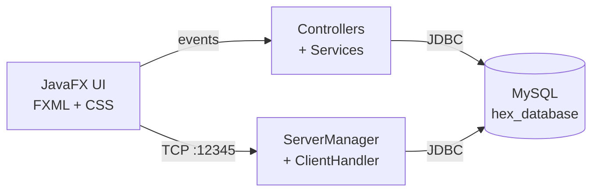

<p align="center">
  
</p>

<h1 align="center">H.E.X - Health, Education, eXploration</h1>

<p align="center">
  A JavaFX desktop application that puts essential city services in one place:<br>
  hospital beds &amp; ICU, medical test prices, blood banks, library, tutors and parking.
</p>

<p align="center">
  
  
  
  
  
</p>

---

## Table of Contents

1. [About the project](#about-the-project)
2. [Features](#features)
3. [Tech stack](#tech-stack)
4. [Architecture](#architecture)
5. [Project structure](#project-structure)
6. [Database](#database)
7. [Getting started](#getting-started)
8. [How to use](#how-to-use)
9. [Known issues and roadmap](#known-issues-and-roadmap)
10. [Documentation](#documentation)
11. [Authors](#authors)

---

## About the project

Information people need every day is scattered: a hospital's free ICU beds are only known by phone, test prices
differ from hospital to hospital, a verified home tutor is found by word of mouth, and parking is found by driving
around. **H.E.X** brings these services together in a single, easy-to-use desktop app.

- **Guests** can use all main services without signing in.
- **Registered users** can also chat with administrators.
- **Department administrators** (Health, Education, Others) keep their own data up to date.

The app is written in **Java 21 with JavaFX** (FXML screens styled with CSS), stores data in **MySQL through JDBC**,
and contains a small **multi-threaded TCP socket server** used by the chat feature.

## Features

### Health
| Feature | What it does |
|---|---|
| **ICU & Beds** | Search hospitals by location and see available beds and ICU units |
| **Health Tests** | Search a test (Ultrasound, MRI, COVID-19 PCR, X-Ray ...) and compare fees across hospitals |
| **Blood Bank & Pharmacy** | Find hospitals that have blood and a pharmacy in a chosen area |

### Education
| Feature | What it does |
|---|---|
| **Library** | Browse the book catalogue: library, availability and price |
| **Find Tutors** | List of tutors (subjects, class, expected salary) - **only administrator-verified tutors are shown** |

### Exploration
| Feature | What it does |
|---|---|
| **Parking** | List of parking slots with location and area |

### Communication and administration
- **Chat** between signed-in users and administrators (messages are stored in MySQL).
- **Health admin console** - update ICU status and bed counts.
- **Education admin console** - add / update / delete books, verify or delete tutors.
- **Others admin console** - update or delete parking slots.
- **Account tools** - sign up, sign in, delete account, contact and bug-report dialogs.
- **Guest mode** - no login required for the main services.

<!--
### Screenshots
Add your screenshots to docs/screenshots/ and uncomment the lines below.

| Home | Dashboard |
|---|---|
|  |  |

| ICU & Beds | Admin console |
|---|---|
|  |  |
-->

## Tech stack

| Layer | Technology |
|---|---|
| Language | Java 21 |
| UI | JavaFX 21.0.1 (FXML + CSS), ControlsFX 11.1.2, FormsFX 11.6.0, ValidatorFX 0.4.0, BootstrapFX 0.4.0 |
| Database | MySQL 8 with Connector/J 8.0.33 (JDBC) |
| Networking | `java.net` sockets, thread pool (chat server on port **12345**) |
| Build | Maven (wrapper included - no separate Maven install needed) |
| Modules | Java Platform Module System (`module-info.java`) |
| Testing | JUnit Jupiter 5.9.2 (configured) |

## Architecture



- **Presentation layer** - FXML screens and CSS (`modern.css`, `animations.css`).
- **Controllers / services** - handle user actions and run prepared SQL statements.
- **Socket server** - `ServerManager` (singleton) accepts clients on port 12345 and hands each one to a `ClientHandler`
  running in a thread pool. It also creates the database and tables on first start if they do not exist.

## Project structure

```text
HEX-Health-Education-Exploration/
├── Main_Interface/                      # Maven project
│   ├── pom.xml
│   ├── mvnw / mvnw.cmd / .mvn/          # Maven wrapper
│   └── src/main/
│       ├── java/
│       │   ├── module-info.java
│       │   └── main/ahbab/main_interface/
│       │       ├── HomeScreen.java              # application entry point
│       │       ├── HomeScreenController.java
│       │       ├── UserController.java, UserSignUpController.java, ChatSystemController.java
│       │       ├── Admin/                       # Health, Education, Others consoles + admin chat
│       │       ├── User/                        # dashboard, health, tutor, parking screens
│       │       ├── server/                      # ServerManager, ClientHandler (sockets)
│       │       └── service/                     # UserService, HealthService
│       └── resources/main/ahbab/main_interface/
│           ├── *.fxml, Admin/, User/            # 21 FXML screens
│           ├── styles/                          # modern.css, animations.css
│           └── sql/schema_hex.sql               # compact schema + sample data
├── database/
│   └── hex_database.sql                 # full database dump
├── docs/
│   ├── logo.png
│   └── HEX_Complete_Project_Documentation.pdf
└── README.md
```

## Database

Database name: **`hex_database`** (MySQL 8, `utf8mb4`).

| Table | Purpose |
|---|---|
| `users` | Users and administrators (`role`: USER / ADMIN, `department`: HEALTH / EDUCATION / OTHERS) |
| `messages` | Chat history between users |
| `hospital` | Hospital name, location, blood bank, pharmacy, ICU status |
| `beds` | ICU and bed counters per hospital |
| `healthtest` | Test prices per hospital |
| `parking_slot` | Parking locations |
| `book_keeper` | Library catalogue |
| `hiretutors` | Tutors with an `Adminverified` flag |
| `health_records` | Optional per-user health data (JSON) |

## Getting started

### Prerequisites

- **JDK 21** - check with `java -version`
- **MySQL 8** running on `localhost:3306`
- **Git** (to clone the project)
- *Optional:* IntelliJ IDEA

### 1. Clone the repository

```bash
git clone https://github.com/Rahil03-git/HEX-Health-Education-Exploration.git
cd HEX-Health-Education-Exploration
```

### 2. Create the database

The app connects as **user `root` with password `root`** (set in the source code - see
[Known issues](#known-issues-and-roadmap)). Make sure your MySQL root password matches, then run the compact
schema and sample data script:

```bash
mysql -u root -p < Main_Interface/src/main/resources/main/ahbab/main_interface/sql/schema_hex.sql
```

> This script starts with `DROP DATABASE IF EXISTS hex_database` - it recreates the database from scratch.

To enable **user sign-up**, add the e-mail column that the sign-up code expects:

```sql
ALTER TABLE hex_database.users ADD COLUMN email VARCHAR(100);
```

*(Alternative: import the full dump `database/hex_database.sql` into an existing empty database named `hex_database`.)*

### 3. Run the application

```bash
cd Main_Interface

# macOS / Linux
./mvnw clean javafx:run

# Windows
mvnw.cmd clean javafx:run
```

The first run downloads JavaFX and the other libraries from Maven Central. Keep **port 12345** free - the chat
server starts automatically with the home screen.

**IntelliJ IDEA:** open the `Main_Interface` folder, let Maven import the project, then run
`main.ahbab.main_interface.HomeScreen`.

## How to use

1. Start the app and choose **Guest Access** to use the services without an account.
2. From the dashboard open **Check Beds**, **View Tests**, **Blood Services**, **Browse Library**,
   **Find Tutors** or **Find Parking**.
3. Choose **User Login** (or *Account > Sign In*) to unlock the **Chat** with administrators.
4. Choose **Admin Login** with a seeded department admin account (see `schema_hex.sql`) to manage Health,
   Education or Others data.

> The accounts in the SQL script are **sample data for demonstration only**.

## Known issues and roadmap

This is an academic project; the following points are known and planned:

- [ ] Passwords are stored as plain text - hash them (BCrypt).
- [ ] Database credentials (`root` / `root`) are repeated in several classes - move to one configuration file and use a connection pool.
- [ ] `users.email` is missing from the SQL scripts, so sign-up needs the `ALTER TABLE` shown above.
- [ ] Chat messages are saved to MySQL but not pushed live to the other party - add real-time broadcasting.
- [ ] Developer "User Manager" console is only partly implemented.
- [ ] Tutor self-registration, parking reservation and per-user health records are prototypes / not yet built.
- [ ] Sample hospital data uses US cities - replace with local data.
- [ ] Add unit tests (JUnit is already configured).

## Documentation

A complete project report (architecture, database design, workflows, security review, test cases, viva guide) is
available at [`docs/HEX_Complete_Project_Documentation.pdf`](docs/HEX_Complete_Project_Documentation.pdf).

## Authors

- **Md Ahbab Hamid Khan** - lead developer
- **Kazi Shibli Zaman Rahil** - [@Rahil03-git](https://github.com/Rahil03-git)

<!-- Add teammates here, for example:
- **Name** - role - [@github-username](https://github.com/github-username)
-->

---

<p align="center">Built with Java, JavaFX and MySQL.</p>
